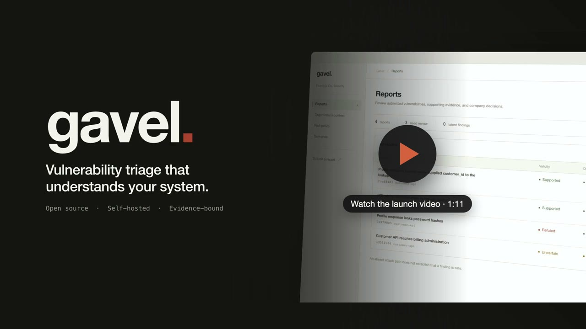

# Gavel

Gavel lets companies receive vulnerability reports from security researchers on their own infrastructure.
It uses a connected AI model, company code, system connections, and risk rules to assess reports and consider how smaller weaknesses could combine.
Follow the [quick start](QUICKSTART.md) to run it locally.

