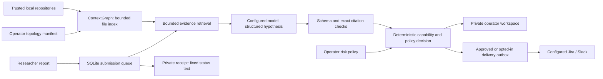

# Gavel contextual triage architecture

This repository now contains a self-hosted, single-organization triage service and a web workspace. It keeps company context between reports, checks model citations against indexed source, evaluates conditional attack capabilities, and queues eligible findings for company-configured Jira or Slack destinations. Its conclusions remain **static hypotheses**. It does not automatically discover every internal system or prove exploitation in a running environment.

## What changed from the original product

The original Python CLI and web verifier followed a one-shot workflow: parse a report with regular expressions, search a small selection of code files, compress the retrieved text, and ask a model for `VALID` or `INVALID`. There was no persistent organization inventory, deployment graph, company policy, submission queue, ownership mapping, or delivery lifecycle. Removing imports and changing line layout also weakened source attribution. Missing context, suspicious instructions, and malformed responses could become `INVALID`; apparent AI authorship could count against a report.

The v2 service uses the new modules below. The older CLI remains a compatibility tool; it is not the contextual service. The old web `/api/verify` endpoint returns HTTP 410 and no longer clones repositories or runs a report-selected search command.

## Components and data flow

| Module | Responsibility |
| --- | --- |
| `gavel/context.py` | Organization-scoped sources, file hashes, bounded Python definition/call syntax graphs, topology replacement, current graph revision, bounded cited evidence. |
| `gavel/store.py` | Durable reports, receipt-token hashes, queue claims, policy versions, generation checks, outbox and audit records. |
| `gavel/triage.py` | Strict model schema, citation validation, provisional primitives, bounded capability closure, contextual disposition. |
| `gavel/server.py` | JSON API, authentication, input and rate limits, context synchronization, worker lifecycle. |
| `gavel/integrations.py` | Configured destinations, limited outbound payloads, retries and stale-event cancellation. |
| `web/app/` | Researcher intake and receipt lookup; authenticated inbox, inventory, policy editor and delivery view. |

The browser calls the allowlisted Next.js `/api/gavel/...` proxy. The proxy forwards bearer tokens to a fixed deployment-configured Python origin; it never adds an operator credential. Collector operations such as topology replacement and synchronization use the Python operator API directly rather than the browser proxy.

## Context is incremental and attributable

Each repository or topology collector owns a named contribution. IDs cannot overwrite another source's nodes or edges within the organization. Repository file IDs are `source_id:relative/path`. Synchronization scans and hashes bounded text files, updates changed contents, and deletes removed file facts; unchanged contents are retained. It still scans the configured repository to discover changes. It is not a line-diff parser or a commit webhook implementation.

The current bounds include 3,000 indexed files, 256 KiB per file and 12 MiB total text per repository. A total scan-budget failure preserves the preceding index. Binary, generated and likely secret files are skipped. Safe descriptor-based reads reject symlinks and avoid running repository code, build hooks, imports, package installers or uploaded proofs of concept.

Python files also produce a conservative AST graph: function, async-function and class symbols; `code_defines` relationships; and `code_call` hypotheses for bare-name calls that resolve to one same-file lexical definition. Parameter shadowing, rebindings, duplicate definitions, wildcard imports and dynamic attribute dispatch prevent such resolution. Every derived object carries its parent file, source hash and line provenance. Both relationship kinds are excluded from attacker movement, and resolved syntax still declares runtime reachability unknown. They do not establish a deployed route, an enforced control or a feasible exploit path.

Unchanged file hashes skip AST parsing. Changing or deleting a file replaces only its owned derivations. Python parse errors and per-file AST/object limits retain source evidence with an explicit `parse_status`, while unsupported languages remain file evidence without invented symbols. Extraction is limited to 12,000 AST nodes, 200 symbols and 600 code relationships per file, with a checked processing-time budget and a source-wide object/metadata bound. The parser is in-process and never executes source; a dedicated isolated parsing worker is further hardening for hostile repositories. Retrieval includes only the selected files' syntax helpers and reserves most of its budget for original source, recording optional graph omission separately from missing source context.

Topology comes from an authenticated operator or trusted collector manifest. It can describe services, owners, public exposure, initial attacker capabilities, reportable assets, and relationships with prerequisite and granted capabilities. Nodes may bind `code_paths` to `code_source_ids`. An unbound path that matches multiple repositories is treated as ambiguous and yields an incomplete-context signal rather than mixing implementations.

Evidence retains original text and line numbers, a SHA-256 content hash, its source ID and source revision. The graph revision is a deterministic hash of current source identities, versions and content digests, including extractor version and derived graph content. `synced_at` records when a source was last refreshed; updating that timestamp alone does not change the graph revision. Current state is persisted; full historical graph snapshots and previous source contents are not retained.

Deleting a source removes its facts. Relationships whose endpoints no longer exist are omitted from snapshots. Changed graph revisions requeue reports and cancel pending superseded delivery events. The implementation currently re-evaluates the organization queue, rather than using a fine-grained dependency index to re-evaluate only affected findings. Policy updates also requeue reports.

## Three decisions, with different meanings

Technical validity asks whether indexed evidence supports or refutes the report. Its values are `supported`, `refuted` and `uncertain`. Citation checks establish that quoted text exists at retrieved source lines; they do not establish that the model interpreted the code correctly or that deployment behavior matches the source.

Applicability records whether the organization context is sufficient and whether useful behavior depends on unmet conditions. Values are `in_context`, `conditional` and `unknown`. Source freshness, omitted evidence, ambiguous repository bindings and bounded exploration can force review.

Disposition is the organization's response: `review`, `fix`, `monitor`, `accepted` or `not_applicable`. Priorities are action-oriented (`review`, `act`, `schedule`, `watch`, `none`). Accepting a risk does not rewrite a supported bug as refuted. These labels are Gavel's own schema, not a CVSS score or a claim of SSVC conformance.

Models propose primitives with `requires` and `provides` capabilities and cited evidence. Capabilities are asset-scoped; trusted topology relationships describe movement between scopes. Supported findings from the current graph revision can contribute provisional primitives to other findings' chain analysis. Unknown or blocked relationships never grant access. Missing prerequisites remain visible, so a contained primitive can be monitored and re-evaluated when context or another finding changes.

The deterministic evaluator compares capabilities and protected-target reach with a baseline that excludes the current finding. Existing reachability alone must not make an unrelated report urgent. Exploration is bounded and incomplete results remain subject to review. This is a conservative capability model, not a full solver for timing, mutually exclusive identities, negative conditions, probability or exploit reliability.

Policy supports protected assets, maximum source age, explicit expiring risk acceptances, and an `auto_route` switch that defaults to false. An acceptance is tied to an asset, primitive and evidence fingerprint, with a reason and expiry. Changing the cited source invalidates that evidence binding. A protected-asset escalation cannot be suppressed by an otherwise matching acceptance.

Freshness and acceptance expiry are checked during analysis and by a periodic decision refresh every 60 seconds. This refresh recomputes policy and chain decisions from saved analysis; it does not rescan repositories or rerun a model. Synchronization or explicit re-evaluation is required to analyze changed code.

## Public and private interfaces

The public program lists only nodes explicitly marked `reportable`, exposing their IDs and names. Researchers submit exactly `title`, `description` and `asset_id`; they cannot select a repository, path, model, policy or webhook. `POST /v1/reports` returns HTTP 202 with a random report ID and receipt token. Only the token's SHA-256 hash is stored. Receipt lookup requires that token in a bearer header.

Receipt responses use fixed status messages and safe outcome labels: `evidence_supported`, `not_supported_by_current_evidence`, or `requires_review`. They do **not** release model reasoning, source, graph topology or owner identity. The wording describes the current evidence assessment and does not claim runtime reproduction. A richer operator-approved, redacted explanation is follow-on work. The web interface retains tokens in tab memory rather than browser storage.

| API surface | Access and behavior |
| --- | --- |
| `GET /healthz`, `GET /v1/program` | Public service health and explicitly public disclosure assets. |
| `POST /v1/reports` | Public or optional shared submission bearer; bounded JSON intake. |
| `GET /v1/reports/{id}` | Report-specific receipt bearer; fixed status and safe outcome. |
| `/v1/admin/graph`, `/reports`, `/reports/{id}`, `/policy`, `/outbox`, `/audit` | Operator bearer; private context, assessments, policy and operational records. |
| `POST .../reports/{id}/reevaluate`, `POST .../approve` | Operator-triggered re-analysis or eligible delivery. |
| `POST /v1/admin/sync`, `PUT /v1/admin/topology`, `DELETE /v1/admin/sources/{source_id}` | Operator-only context mutation. |

## Models and delivery

The model uses an operator-configured OpenAI-compatible HTTP API. An on-premises deployment can keep analysis inside its own network. External models require HTTPS, an explicit external data-boundary declaration, and `GAVEL_ALLOW_EXTERNAL_AI=true`. Configuration describes the intended boundary; it does not independently attest where a model runs. Redirects are disabled and response sizes and timeouts are bounded. The model has no execution or browsing tools.

Only supported findings with an eligible disposition enter the delivery outbox. Manual approval is the default; operators can explicitly enable automatic routing. Slack uses a configured `hooks.slack.com` webhook. Jira uses a configured HTTPS origin, project and credential environment variables, with owner identifiers mapped to Jira account IDs by company configuration. Report prose, model summaries and code excerpts are excluded from outbound messages, preventing those strings from becoming mentions or rich markup.

Delivery retries use stable event IDs and an idempotency header, but Jira and Slack do not guarantee universal deduplication. Semantics are at least once: duplicates remain possible after uncertain network outcomes or process crashes. Graph changes cancel stale pending events. Periodic and pre-approval decision refreshes also cancel pending or failed events when freshness or risk changes make delivery ineligible or change its decision metadata. They cannot retract a notification already delivered. The outbox and audit endpoints expose states for operator investigation.

## Deployment boundaries and next work

Run one service process and worker against its SQLite database. Organization columns prevent accidental cross-organization queries, but the shipped deployment is single-organization; static shared operator tokens are not user identities or enterprise role-based access control. A process-local mutation lock and a thread-safe graph connection support the current worker, not distributed coordination. The UI inbox returns at most 500 records, while `Store.decisions()` supplies the complete saved decision dataset to security analysis so old findings do not disappear from chain reasoning when they leave the inbox. Primitive, edge and iteration limits still bound path exploration; exceeding them requires review.

Production expansion should add authenticated cloud/Kubernetes/IAM collectors with attestable freshness, semantic code analyzers, dependency-based invalidation, retained graph history, database retention and encryption policy, SSO and per-user audit attribution, distributed queue leases, delivery reconciliation, and an adversarial evaluation corpus. Any runtime verification runner needs a separately designed disposable sandbox, network authorization, resource limits and independent execution evidence; none exists in this release because the service executes no submitted code.

## Design references

[FIRST CVSS v4.0](https://www.first.org/cvss/v4.0/specification-document) separates intrinsic severity from threat and environmental context and includes effects on subsequent systems. Gavel uses that distinction as motivation for keeping technical assessment and company context separate; it does not implement CVSS calculation.

[CISA's SSVC guide](https://www.cisa.gov/sites/default/files/publications/cisa-ssvc-guide%20508c.pdf) provides a reference for stakeholder-specific remediation decisions. Gavel's action labels are an independent initial policy model, not the CISA decision tree.

[OpenVEX](https://github.com/openvex/spec/blob/main/OPENVEX-SPEC.md) relates a vulnerability's status to a specific product and time. That is a useful direction for future versioned applicability interchange; Gavel does not currently import or export compliant OpenVEX documents.

[OWASP's AI Agent Security guidance](https://cheatsheetseries.owasp.org/cheatsheets/AI_Agent_Security_Cheat_Sheet.html) informs the separation of untrusted content from authority, restricted tools, validated output and independent action authorization. These design choices reduce prompt-injection impact; they do not make the model immune to manipulation.
